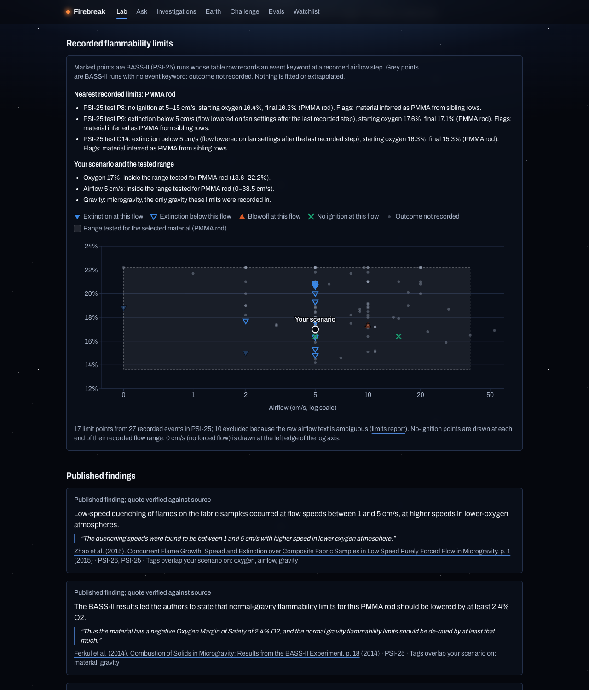
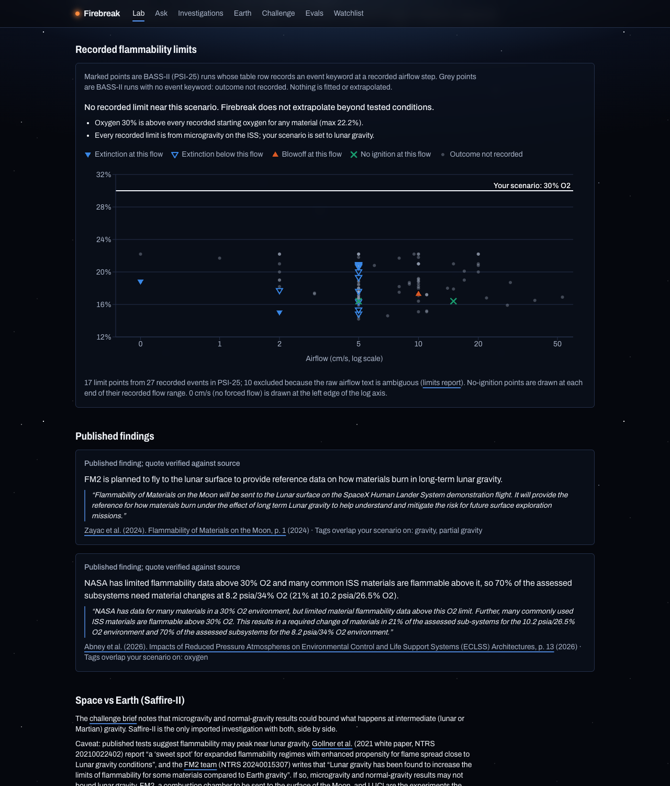
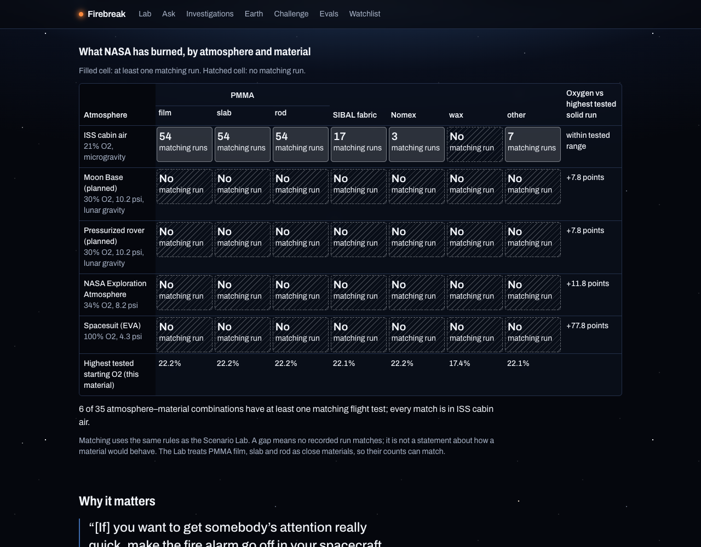
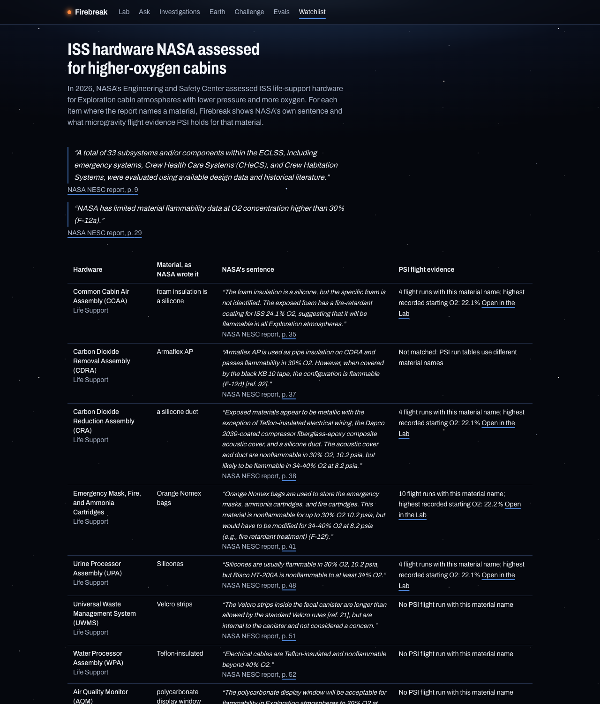
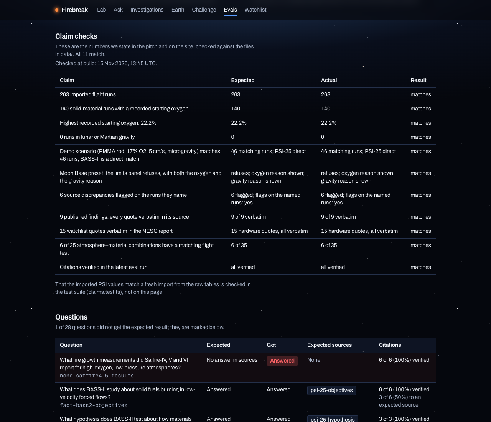

# Firebreak 🔥

**What NASA has burned in space, and what it hasn't.**

NASA is planning a Moon Base that will likely run at **30% oxygen or more**. NASA's solid-material flight tests we imported (BASS-II, Saffire-I, Saffire-II) include 140 with a recorded starting oxygen; the highest is **22.2%**. Higher-oxygen microgravity tests exist: ACME CFI-G flowed up to 85% oxygen through a gaseous-fuel burner ([challenge brief](https://www.spaceappschallenge.org/2026/challenges/flame-in-freefall/)), but none of the imported solid-material runs with a recorded starting oxygen started above 22.2%. None of the 263 imported runs were in lunar or Martian gravity.

Firebreak makes that kind of gap visible. Pick a habitat scenario, and it ranks NASA's microgravity combustion investigations by how closely they match, shows the actual test runs behind each one, points out where the evidence runs out, and answers questions using only text it can cite and verify.

**Live:** https://nasa-2026-nine.vercel.app
**Built for:** [NASA Space Apps Challenge 2026: Flame in Freefall](https://www.spaceappschallenge.org/2026/challenges/flame-in-freefall/), Montréal

## What it does

- **Scenario Lab** (`/lab`): set material, oxygen, airflow and gravity, or use a preset ("ISS cabin air", "Moon Base (planned)", "Pressurized rover (planned)", "NASA Exploration Atmosphere", "Spacesuit (EVA)"). Investigations are ranked with a per-dimension breakdown, and the matching runs light up on a chart. Pressure is context only; the imported run tables do not record it.
- **Coverage grid**: material × oxygen band, every cell a count of real tests. The empty cells are the story. A separate column shows runs whose source tables never recorded oxygen at all.
- **Where the evidence runs out**: plain sentences computed from the data, like "No solid-material run with a recorded starting oxygen (140 of 263) started above 22.2%; your scenario is 30%." No risk scores, no verdicts.
- **Recorded flammability limits**: BASS-II extinction, blowoff and no-ignition records, with nearest limits and the material's tested ranges. Of 27 event candidates, 17 are included and 10 excluded with reasons in the [limits report](pipeline/limits_report.md). Bounds such as "below 5 cm/s" stay bounds; nothing is fitted or extrapolated.
- **Published findings**: up to three findings selected from nine entries across six NTRS papers. Each quote is checked as an exact substring of its corpus source, then shown with its source link and overlapping tags. Any tag can match, so a fabric finding can appear for a PMMA scenario through oxygen, airflow or gravity overlap.
- **What varied and what was held fixed**: dimensions computed from the imported runs, with missing values and flags visible. **Space vs Earth** shows Saffire-II's recorded microgravity and 1-g burn lengths with a partial-gravity caveat.
- **Ask the evidence** (`/ask`): questions are answered only from NASA text. Every quote is checked word for word against its source before it's shown. If the sources don't cover it, the app says so (status `insufficient_evidence`) instead of answering.
- **Scorecard** (`/evals`): saved results from a fixed set of 28 golden questions, failures included. In the latest run, 27 of 28 questions got the expected result, 90 of 90 citations were verified word for word, and 6 of 7 unanswerable questions were declined. The one miss (`none-saffire4-6-results`, which should have been declined but was answered) is shown on the page, not tuned away.
- **Claim checks** (`/evals`): the numbers we state in the pitch and on the site, recomputed from the shipped data when the site is built, each shown with its expected value, actual value and "matches" or "does not match".
- **Evidence Gap Atlas** (landing page): every Lab preset against every material family that has a recorded starting oxygen, using the Lab's own matching. 6 of 35 combinations have at least one matching imported flight run; every cell links to the Lab with that scenario.
- **Hardware watchlist** (`/watchlist`): ISS hardware that NASA's NESC report ([NTRS 20260003925](https://ntrs.nasa.gov/citations/20260003925)) assesses for higher-oxygen cabins, each with a verbatim quote from the report beside the imported PSI runs for its material.
- **Earth applications** (`/earth`): how microgravity fire research relates to fire safety on Earth, using quoted brief text, PSI records and NASA Spinoff pages only.
- **Challenge mapping** (`/brief`): the challenge brief's own words, matched to where Firebreak addresses each one.
- **Printable report** (`/lab/report`): the current Lab scenario as a print-ready page you can save as a PDF.
- **Investigations** (`/investigations`): all 24 PSI combustion investigations, filterable by safety area (prevention, detection, suppression, fundamental).
- **Download** the cleaned dataset as CSV or JSON, with every data-quality flag attached.

## The data

| Source | What we use |
|---|---|
| [NASA PSI](https://psi.nasa.gov) experiment tables | 263 test runs: BASS-II (PSI-25), BASS (PSI-26), Saffire-I, II, III (PSI-98, 99, 100) |
| PSI investigation pages | Objectives, approach and hypotheses for 24 combustion investigations |
| *A Researcher's Guide to: Combustion Science* | Page-level text for the Ask feature |
| NASA pages on Apollo 1, Apollo 13, the Mir fire and Glenn's combustion science program | Context for why this matters, and text for the Ask feature |
| Six NTRS papers listed in [REFERENCES.md](REFERENCES.md#sources-used-in-scenario-lab) | 150 page documents for retrieval and nine published findings; these do not add run rows |

Raw NASA files live unmodified in `data/raw/`. The importers never correct a value: anything the source can't support (an impossible oxygen reading, a date that disagrees with its GMT day, airflow logged as a fan setting) becomes `null` plus a visible flag. Full column notes: [BASS-II](pipeline/psi_bass2_columns.md), [BASS](pipeline/psi_bass_columns.md) and [Saffire](pipeline/psi_saffire_columns.md). See the [import report](pipeline/psi_import_report.md) and [corpus report](pipeline/corpus_report.md) for counts and provenance.

## How it works

- **Import the evidence.** Scripts build JSON in the repo from PSI tables, investigation pages, the guide, NASA web pages and NTRS papers. No database; raw sources stay unchanged.
- **Code ranks, AI explains.** Deterministic functions rank investigations, identify gaps and extract recorded limits. Published findings are verified against the corpus before tag matching selects them for the Lab.
- **Retrieve and cite.** BM25+ keyword search (MiniSearch) supplies text to `/api/ask`. The model must quote it; the server checks quotes against the cited documents and drops citations that fail. Quote matching checks provenance; it does not prove a paraphrase follows from its quote.

## Screenshots

Captured from the deployed site on 15 November 2026 with headless Chrome at 1280 px wide.

<details>
<summary>PMMA rod demo: recorded limits and published findings</summary>

[Open this scenario](https://nasa-2026-nine.vercel.app/lab?material=PMMA%20rod&o2=17&flow=5&gravity=micro#limits-heading)



</details>

<details>
<summary>Moon Base: limits refusal and published findings</summary>

[Open this scenario](https://nasa-2026-nine.vercel.app/lab?o2=30&pressure=10.2&gravity=lunar#limits-heading)



</details>

<details>
<summary>Evidence Gap Atlas: every preset against every material</summary>

[Open the atlas](https://nasa-2026-nine.vercel.app/#atlas-heading)



</details>

<details>
<summary>Hardware watchlist: ISS hardware assessed in the NESC report</summary>

[Open the watchlist](https://nasa-2026-nine.vercel.app/watchlist)



</details>

<details>
<summary>Claim checks and scorecard</summary>

[Open the scorecard](https://nasa-2026-nine.vercel.app/evals#claim-checks)



</details>

## Stack

Next.js (App Router) · TypeScript · Tailwind · shadcn/ui · Recharts · Vercel AI SDK with OpenAI (`gpt-5.4-mini`) · MiniSearch · Vitest · deployed on Vercel

## Run it locally

```bash
npm install
cp .env.example .env.local     # add OPENAI_API_KEY (only /ask needs it)
npm run dev                    # http://localhost:3000
```

Rebuild the data and check it:

```bash
npm run import:psi     # PSI tables → data/runs.json (fails loudly if anything looks off)
npm run build:corpus   # PSI pages + guide + NASA pages + papers → investigations.json and corpus.json
npm test               # parsers, matcher, retrieval, citation checks
npm run evals          # rerun the scorecard (uses the API key)
```

## Limits, honestly

- All imported runs are from orbit (ISS or Cygnus); none are at lunar or Martian gravity. The [challenge brief](https://www.spaceappschallenge.org/2026/challenges/flame-in-freefall/) (Details tab, "Partial-gravity data") describes future PSI additions such as LUCI and FM2. NASA Glenn's [Combustion Science page](https://www.nasa.gov/glenn/glenn-expertise-space-exploration/physical-sciences-program/combustion-science/) lists FM2; it is not among the 24 PSI investigations we imported.
- The [FM2 poster](https://ntrs.nasa.gov/citations/20240015307) discusses laboratory work and prior simulated-lunar-gravity evidence. It reports no completed lunar-surface results; the Lab's FM2 finding describes the planned measurement.
- Runs without starting oxygen or numeric airflow are counted but omitted from the scatter plot. A run with no event keyword has "outcome not recorded"; it is not evidence that burning continued.
- This is a research and exploration tool, not a flammability certification or a safety rating.

## Source discrepancies we found

Where a PSI table disagrees with NASA's own published papers, Firebreak keeps the PSI value and flags the difference. We found 6 such discrepancies in the Saffire tables: dimensions, thickness, airflow and missing starting oxygen. The [source-discrepancy audit](pipeline/source_discrepancies.md) lists affected runs, PSI values, published values and citations. Flags appear in the runs table, what-varied panel and CSV export; papers never silently replace or fill PSI values.

## Team

- **Yousef Yousef** ([@YousefAkay](https://github.com/YousefAkay)): data pipeline, Scenario Lab, matching and gap analysis
- **Yusuf AlMahoozi** ([@Mahoozi](https://github.com/Mahoozi)): investigation catalog, retrieval, cited Q&A, evaluation

Built at the 2026 NASA Space Apps Challenge, Montréal. Uses NASA open data; not affiliated with or endorsed by NASA. MIT licensed.
